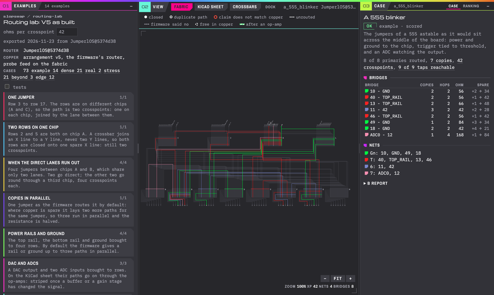
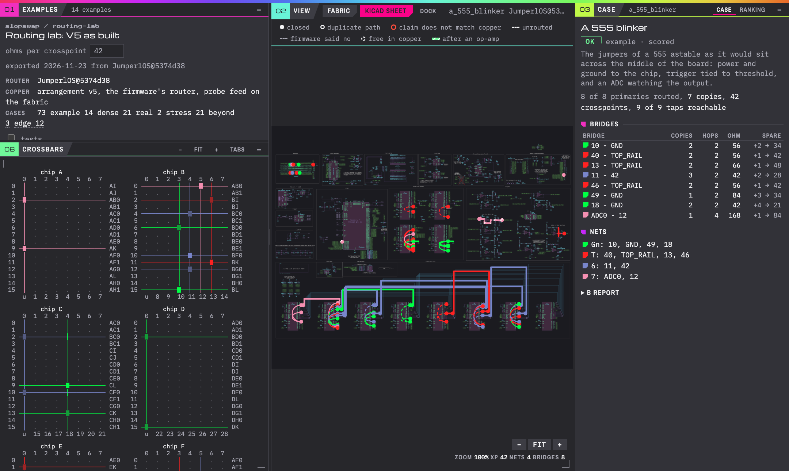
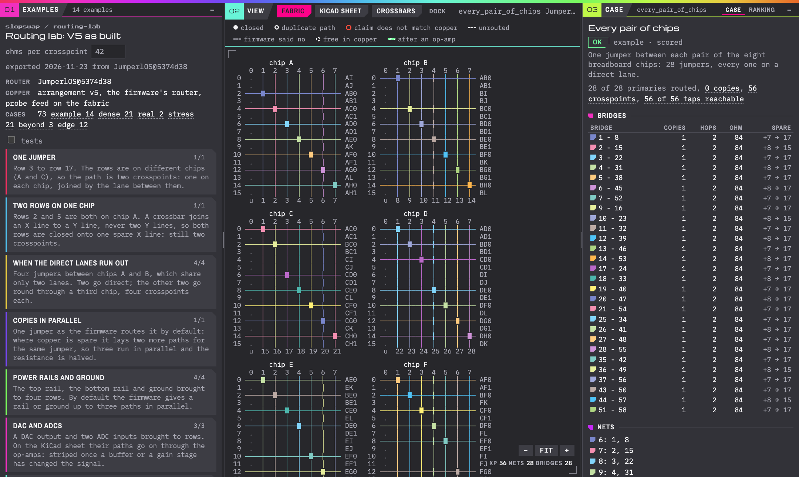
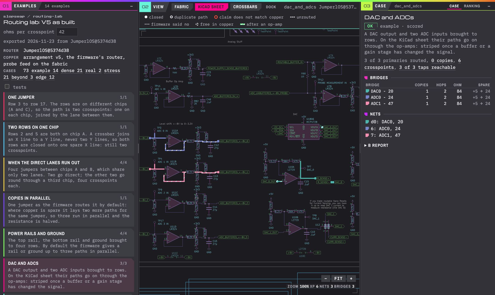
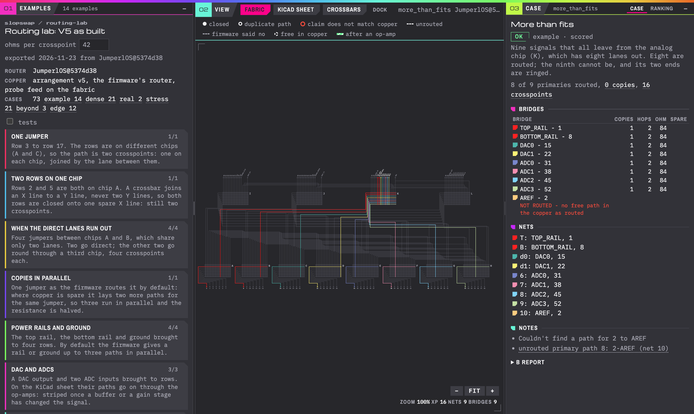
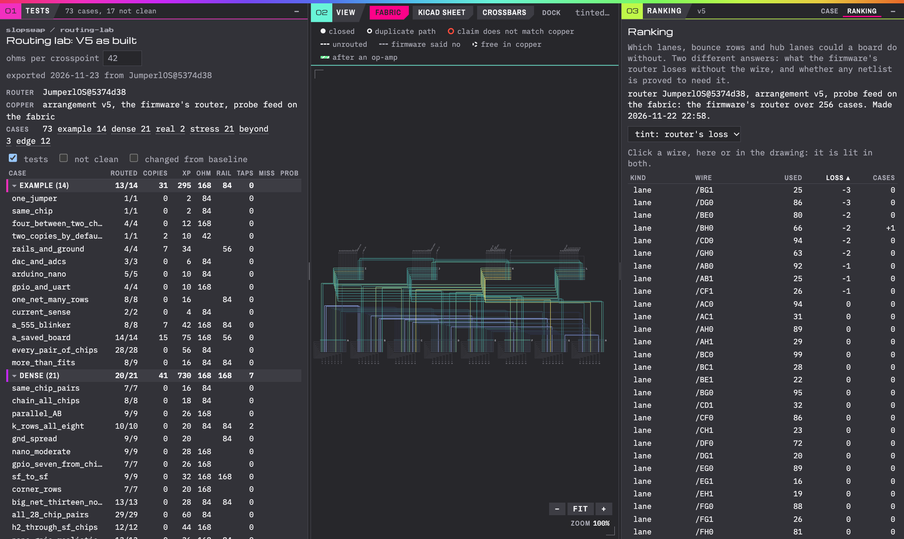

# Jimulator

Jumperless, off the board. The first piece here is **Routing**: the Jumperless V5 firmware's own router, running on
a computer instead of the board, with everything it decides drawn for you.

**[Open it in your browser: slopswap.org/routing-lab/v5.html](https://slopswap.org/routing-lab/v5.html)**.
Nothing to install. The same thing on the copper V6 is heading for, with the probe's feed off the crossbars:
[v6-feed-off.html](https://slopswap.org/routing-lab/v6-feed-off.html).



## What you are looking at

A Jumperless has no jumper wires. Under the breadboard sit twelve crossbar switch chips, A to L. Each can join any
of its 16 X lines to any of its 8 Y lines. The breadboard's rows, the Arduino Nano header, the DACs, ADCs, GPIO
and the power rails are wired to those lines, and lanes of copper run from chip to chip. A jumper from row 3 to
row 17 is two closed crosspoints, one on each row's chip, and the lane between them.

Choosing which crosspoints to close for a whole circuit is the router's job. This page runs the real router (the
firmware's C++, built for the host, nothing reimplemented) on a list of circuits and shows what it did with each.

## How to use it

### 1. Pick an example

The left panel lists small circuits. Each shows one kind of routing; click one and the middle panel draws it.

| Example | What it shows |
|---|---|
| One jumper | Two rows on different chips: two crosspoints and a lane |
| Two rows on one chip | A crossbar joins X to Y, never Y to Y, so both rows close onto one spare X line |
| When the direct lanes run out | Four jumpers between two chips that share two lanes: two go round through a third chip |
| Copies in parallel | What the firmware does by default: extra paths for the same jumper, for less resistance |
| Power rails and ground | Rails and ground brought to rows, three paths each where there is room |
| DAC and ADCs | Analog in and out, which go on through op-amps (step 4) |
| Arduino Nano header | Header pins to rows, through the two chips the header sits on |
| GPIO and serial | GPIO to rows and the UART crossed onto the Nano's D0 and D1 |
| One net on many rows | Ground on eight rows: one net, one colour |
| Current sense | The sense resistor's two ends brought to two rows |
| A 555 blinker | A whole small circuit as it would sit on the board |
| A saved board | A real session saved from a board: 13 jumpers |
| Every pair of chips | 28 jumpers, every direct lane between breadboard chips in use |
| More than fits | Nine signals out of a chip with eight lanes out (step 5) |

### 2. Look at it three ways

The tabs over the drawing pick a view of the same routing:

- **Fabric**: every chip as a grid, with every piece of copper between them. A lit wire carries the net of its
  colour; a dot is a closed crosspoint.
- **KiCad sheet**: the board's own schematic, with the routing drawn over it.
- **Crossbars**: the twelve chips as the board itself prints them when you type `C` in its terminal. A block is a
  closed crosspoint; the wire on each pin is named at the row's end and under the column.

To see more than one at once, drag a tab onto a side of any panel, or press **dock**. Here the crossbars are docked
under the examples and the sheet is in the middle:





### 3. Click things

| Do this | And |
|---|---|
| Click a wire, a crosspoint or a net in the right panel | That net is lit alone, in every view, and a readout says what you clicked |
| Click a jumper's row in the right panel | Its two ends are ringed |
| Click a key in the legend | Only that kind of mark is shown |
| Click the same thing again, the empty drawing, or press Escape | Everything is shown again |
| Arrow keys | Up and down through the examples; right into the jumpers and nets of the one open |
| Wheel or pinch, drag, double-click | Zoom about the pointer, pan, fit. The three buttons in the drawing's corner do the same |
| Drag a panel's name plate onto a side of another panel | The panel moves there. Drag the line between two panels to size them; the button on a plate's bar folds it |
| Double-click a name plate | The panels go back where they started |

The page remembers where you left it: the layout, the view and the example.

### 4. Follow a signal through the op-amps

Open **DAC and ADCs** and the **KiCad sheet**, and zoom in on the analog section. A crossbar wire does not end at
the chip: an ADC input goes through a buffer and a divider before it reaches the microcontroller, and a DAC
is driven through a gain stage. The page follows each lit wire through its op-amp and draws the far side in the
same colour with thin white stripes across it, because the signal there is no longer the same voltage. Rest the
pointer on a striped piece for the part and what it does. (A dashed curve inside a chip is something else: one of
the extra copies of a jumper.)



### 5. See what does not fit

Open **More than fits**. Nine signals all leave from the analog chip, which has eight lanes out. The router routes
eight; the ninth is listed in red in the right panel as not routed, and its two ends are ringed in the drawing.
Ground and the power rails are drawn in the colours the board's own LEDs give them: ground green, a rail red (blue
while it is set negative). A problem's red is told apart by its white edge.



### 6. The tests, and the ranking

Tick **tests** over the examples and the list becomes the battery the router is judged on: cases from the bench
suite, saved boards, cases aimed at one scarce resource each, cases too big on purpose, and random netlists that an
exact solver has proved routable. Each row has its numbers; a click opens it like an example.

**ranking**, on the right panel's bar, lists every lane by what the router loses when that one lane is taken away,
and tints the fabric to match. It is there for designing the next board more than for looking at this one.



## Run it yourself

The web page shows runs made ahead of time. On your own machine the page can also route what you draw:

```bash
git clone --recurse-submodules https://github.com/Architeuthis-Flux/Jimulator.git
cd Jimulator
python3 Routing/lab.py serve
```

That builds the router and opens `http://127.0.0.1:8765/`. It needs Python 3.12 or later and a C++ compiler
(`g++`, or Xcode's command line tools on a Mac). If you cloned without `--recurse-submodules`, run
`git submodule update --init` once.

What you get there that the web page does not have:

- **Your own circuit.** Click a node, then another: that is a jumper, routed at once. Keep clicking to build a
  netlist, starting from nothing or from any example.
- **Your own board.** Type `b` in a Jumperless's terminal, copy what it prints, and paste it on the page (or drop
  a log file): the page draws what that board really routed and checks it against the schematic.
- **A changed router.** Point the lab at a JumperlOS checkout you are editing, and the cases re-run when you save;
  or drop a single source file on the page to try it without touching anything.
- **Other copper.** Crossbar arrangements other than V5's, and an exact solver that says whether a netlist can be
  routed at all on any of them.

`Routing/README.md` has the commands and how the lab is put together.

## What is in this repository

| Folder | What it is |
|---|---|
| `Routing/` | The routing lab: the router built for the host, the cases, the judge, the page. Start with [`Routing/README.md`](Routing/README.md); each folder under it has its own |
| `Routing/web/` | The page itself. [`Routing/web/README.md`](Routing/web/README.md) is the full reference for everything on it |
| `Routing/cases/` | The examples and the test cases. [`Routing/cases/README.md`](Routing/cases/README.md) says how to add an example |
| `Routing/docs/` | What the lab has found so far ([`FINDINGS.md`](Routing/docs/FINDINGS.md)), its design and its plans |
| `JumperlOS/` | The firmware, as a git submodule. The lab reads the router's source and the board's fabric from it and changes nothing in it |

## What it is not

It is the router, not the board. Nothing electrical is simulated: no voltages, no current, no parts. What is checked
is that the crosspoints the router closes connect what was asked for, and nothing else, on the copper the schematic
says is there. [`Routing/README.md`](Routing/README.md) lists what it does not check.
